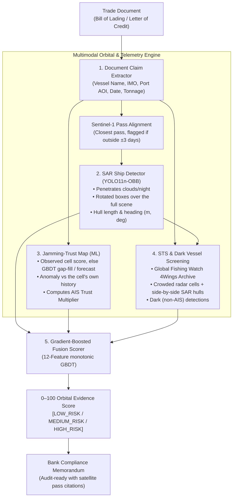

# Bill of Orbit: Satellite Second Opinion for Trade Finance

<div align="center">


-success?style=for-the-badge)


### *"Your bank checks the paper. We check the planet."*

**An autonomous AI and satellite radar pipeline that cross-references maritime trade paperwork against ESA Copernicus Sentinel radar and optical imagery to eradicate trade-finance fraud and false alarms in the Gulf.**

[Problem & Context](#1-problem-statement--why-now) • [Architecture](#2-architectural-decisions--system-pipeline) • [Trained Models](#3-the-ai--satellite-models) • [Backtest Results](#4-backtest-results) • [System Capabilities](#5-system-capabilities--solved-fraud-vectors) • [Business Model](#6-business-model--commercial-viability) • [Quickstart](#7-quickstart--dashboard)

---

</div>

## Executive Summary

### The Problem: $5 Billion in Paper Fraud
* **How Trade Finance Operates:** Banks disburse billions of dollars on Letters of Credit (LCs) by inspecting shipping paperwork (Bills of Lading), never the physical ships.
* **The Vulnerability:** Fraudulent paper claims with non-existent or substituted shipments cost global banking **US$5 Billion annually**, with multiple high-profile cases originating in UAE trading hubs.
* **The Need:** An instant, objective, physical proof-of-shipment verification layer before payout release.

### The Blindspot: Gulf GPS Jamming & Dark Tankers
* **Hormuz Electronic Warfare:** Since Feb 2026, severe GNSS/GPS jamming has affected over **1,650 vessels** in the Strait of Hormuz.
* **AIS Transponders Are Down:** Over **65% of laden crude tankers** now transit the Gulf with AIS transponders turned off or jammed.
* **Legacy Tools Fail:** Traditional vessel-screening software relies on AIS. When a ship's transponder goes dark in a jamming zone, standard tools trigger **costly false alarms**, blocking legitimate multi-million-dollar trades.
* **Offshore Evasion:** Over **70% of crude transfers** have moved offshore to Fujairah and Sohar anchorages, enabling fraudulent reissuance of bills of lading.

### The Solution: The Bill of Orbit Pipeline
* **Autonomous Ingestion:** Extracts vessel claims, IMO, port, date, and cargo tonnage directly from trade documents using NLP.
* **Sentinel-1 Radar Vision:** Uses all-weather, day-and-night Synthetic Aperture Radar (SAR) to locate the vessel and physically measure its hull length in meters.
* **Jamming-Trust Layer:** Evaluates local electronic warfare on 300,000+ GNSS records; down-weights AIS when jammed and relies on radar proof.
* **Offshore Security Screening:** Screens for illicit side-by-side ship-to-ship (STS) transfers and untracked "dark" vessels.
* **Unified Evidence Engine:** Generates a **0–100 Orbital Evidence Score** and an audit-ready compliance memorandum.

### The Jamming Toggle: Eliminating False Alarms
* **Scenario:** A genuine VLCC (330 m declared) whose AIS is off, with a 322 m hull confirmed on Sentinel-1 radar, in the most jammed cell in our data (24.30N 52.45E on 2026-09-01: jam score 0.94 from 85 aircraft).
* **Without Jamming Layer (Legacy AIS Screening):** Missing AIS counts against the ship. **Score 57.2/100 (MEDIUM RISK, manual review)**.
* **With Bill of Orbit:** The layer reads the real jam score, cuts AIS trust to 0.05 and lets the radar evidence decide. **Score 92.0/100 (LOW RISK)**.
* **Where it matters:** jamming is patchy. Only 5% of cell-days in Sep-Oct 2026 reached a jam score of 0.25, and the anchorages (Fujairah, Khor Fakkan, Sohar) had median scores of 0.04-0.08. In clean water the layer correctly changes almost nothing.
* **Impact:** Prevents false transaction halts for GCC trade banks when, and only when, the GNSS environment explains the missing AIS.

### Business Moat & Go-to-Market
* **Target Customers:** Trade-finance and sanctions-compliance desks at UAE and GCC banks (Emirates NBD, FAB, DIB, ADCB), trade credit insurers, and trade-automation platforms.
* **Disruptive Pricing:** **$20–$60 per check** (vs. legacy competitors like Pole Star at $250/check). Annual bank subscriptions at **$60k–$150k ARR**.
* **Copernicus Moat:** Leveraging free European Space Agency (ESA) Sentinel data keeps compute and data costs under $1.50 per check, delivering 90%+ gross margins.
* **GTM Strategy:** Pilot with trade-automation software design partners in DIFC/ADGM sandboxes, expanding to Space42 high-resolution radar pilots.

---

## 1. Problem Statement & Why Now?

### The Core Vulnerability
Banks pay out on Letters of Credit by checking **paper, not cargo**. If an exporter submits an authentic-looking Bill of Lading claiming that 135,000 MT of Arabian Light crude was loaded onto a Suezmax tanker at Fujairah Anchorage, the bank's operational teams approve the payout.

### Why Existing Solutions Fail in the Gulf:
1. **The Hormuz Electronic Warfare Crisis:** Persistent GNSS interference across the Strait of Hormuz has forced over 65% of laden tankers to turn off their AIS transponders. AIS-only screening tools (Windward, Pole Star) are blind or generate constant false alarms.
2. **Cloud and Night Blindness:** Optical satellite imagery (Sentinel-2, Planet) is obstructed by night, cloud cover, and maritime haze.
3. **Offshore Ship-to-Ship (STS) Laundering:** Over 70% of crude crossing Hormuz changes tankers near Fujairah or Sohar. Each transfer is an opportunity to fraudulently reissue a Bill of Lading, disguise cargo origin, or evade sanctions.

---

## 2. Architectural Decisions & System Pipeline

Bill of Orbit fuses multimodal satellite imagery, electronic warfare anomaly detection, and natural language processing into a single automated decision engine.



### Key Architectural Decisions:
1. **Synthetic Aperture Radar (SAR) over Optical:** Radar pulses penetrate cloud cover, sea spray, and night darkness. Sentinel-1C/1D restored 6-day revisit schedules across the UAE coast in 2026, providing guaranteed maritime visibility.
2. **Per-Chip Robust Z-Score Normalization:** OSSDD training chips are raw 32-bit amplitude DN values, while Earth Engine Sentinel-1 GRD imagery is calibrated sigma0 in dB. Converting both to dB and applying per-chip robust z-scoring ($Z = \frac{dB - \text{median}}{\text{MAD} \times 1.4826}$) cancels inter-sensor calibration offsets, allowing the YOLO model to infer seamlessly across both sources.
3. **Decoupled Jamming-Trust Multiplier:** Instead of treating AIS as an absolute binary (present/absent), the jamming model applies a dynamic sigmoid discount. In heavy electronic warfare zones, missing AIS is forgiven; in clean waters, missing AIS is heavily penalized.
4. **Physical Hull Dimension Matching:** 10m radar resolution cannot read painted ship names, but it accurately measures length. Our pipeline maps declared cargo tonnage to physical tanker classes (VLCC, Suezmax, Aframax, Handymax) and computes the length discrepancy ratio.

---

## 3. The AI & Satellite Models

### Model 1: Document Claim Extractor (`document_extractor.py`)
* **Input:** Raw Bill of Lading / LC text or PDF.
* **Extraction:** Vessel Name, IMO Number, Port Coordinates/AOI, Loading Date, Cargo Commodity, and Declared Tonnage.
* **Inference:** Automatically derives the expected vessel deadweight class and physical length in meters (e.g., $135,000\text{ MT} \rightarrow \text{Suezmax} \approx 274\text{m}$, tolerance $\pm 54.8\text{m}$).

### Model 2: SAR Ship Detector (`train_sar_detector.py`, `sar_inference.py`)
* **Architecture:** **YOLO11n-OBB** (rotated boxes) fine-tuned on 2,000 Sentinel-1 chips from the OpenSARShip Detection Dataset (OSSDD), with 400 val and 1,000 held-out test chips from other scenes.
* **Input:** Dual-polarization radar chips ($R = \text{VV}$, $G = \text{VH}$, $B = \text{mean}$), robust z-scored (see above).
* **Output:** Per ship: position (lat/lon), hull length and width from the rotated box's sides at 10 m/px, heading, and confidence. Full Earth Engine scenes are tiled (704 px, 100 px overlap) and duplicates merged.
* **Why rotated boxes:** an upright box overstates the length of any ship not lying north-south or east-west; the earlier detect model overestimated lengths by 8.8 m on average.
* **Training for generalisation:** SAR-safe augmentation only (flips, full rotation, mild scale/brightness, no colour jitter), early stopping (patience 10, best epoch 23 of 33), fixed seed. Thresholds are chosen on val or earlier dates and reported on held-out data.

### Model 3: Jamming-Trust Map & Anomaly Flag (`jamming_model.py`)
* **Dataset:** 300,853 real GNSS-interference records (Stanford ADS-B integrity monitor, H3 res-4 cells, 2026-09-01 to 2026-10-30).
* **How a query is answered:**
  1. If the cell containing the point was observed that day, use the observed score, shrunk toward the model when fewer than 10 aircraft reported.
  2. Otherwise a `HistGradientBoostingRegressor` fills the gap from the cell's **past** (mean, last value, 7-day mean, days since last) and same-day neighbouring cells within 80 km. A second, forecast model (no same-day features, trained with a random 1-14 day horizon) handles dates nobody observed.
  3. Anomaly flag: today's score is more than 3 robust z-units above the cell's own history.
* **Training:** samples weighted by aircraft count (a score from 2 aircraft is mostly noise); depth-4 trees, min leaf 40, early stopping.
* **Output:** Jam score ($0.0$ to $1.0$), anomaly flag, data source, and the **AIS Trust Factor**:
  $$\text{Trust} = \text{clip}\left(\frac{1}{1 + e^{8.0 \cdot (\text{jam\_score} - 0.35)}}, 0.05, 1.0\right)$$

### Model 4: Ship-to-Ship (STS) & Dark Vessel Screening (`sts_detector.py`)
* **Data:** Global Fishing Watch (GFW) 4Wings SAR presence (all detections and dark, non-AIS detections) for Fujairah Anchorage, Khor Fakkan and Sohar, plus our own detections from the matched Sentinel-1 pass.
* **Signals, strongest first:**
  1. Two of our SAR hulls side by side: centres closer than half their summed lengths plus 100 m, headings within 25 degrees.
  2. A GFW radar cell holding 2+ vessels on one date. GFW reports on a 0.01 deg (~1.1 km) grid, so it cannot resolve ships 100-250 m apart; the earlier "<250 m between GFW detections" rule could never fire.
  3. Dark detections within 2 km of the claimed position, within ±1 day.
* **Output:** STS risk score (0.05-0.95), counts, and a plain-language note, including when there is simply no GFW coverage.

### Model 5: Orbital Evidence Fusion Scorer (`fusion_model.py`)
* **Architecture:** `HistGradientBoostingRegressor` with **monotonic constraints**: more radar evidence (detection, confidence, length match) can never lower the score, and more risk (length gap, radar/AIS mismatch, STS risk, dark vessels, days from the pass) can never raise it.
* **Input Features (12):** `sar_detected`, `sar_confidence`, `length_match_ratio`, `length_delta_m`, `ais_reported`, `ais_trust_factor`, `discounted_ais_weight`, `jamming_score`, `radar_ais_discrepancy`, `sts_risk_score`, `dark_vessel_nearby`, `days_from_pass`.
* **Training data:** synthetic, from six scenarios (clean, ghost ship, jammed-but-genuine, STS transfer, size mismatch, dark with no jamming excuse). Length noise uses the detector's **measured** length error from the test backtest, not a guess.
* **Output:** **0–100 Orbital Evidence Score**, Risk Tier (`LOW_RISK`, `MEDIUM_RISK`, `HIGH_RISK`), and an automated **Bank Compliance Memorandum**.

---

## 4. Backtest Results

Every number below is on data the model did not train or tune on. Reproduce with the `backtest_*.py` scripts; raw results are in `reports/`.

### SAR ship detector: OSSDD held-out test (1,000 chips, 4,715 ships)
Confidence threshold chosen on val only; a detection matches a ship at IoU >= 0.3. `python backtest_sar_detector.py`

| Metric | Earlier YOLO11n (upright boxes) | **YOLO11n-OBB (current)** |
|---|---|---|
| Precision | 0.789 | **0.857** |
| Recall | 0.893 | **0.945** |
| F1 | 0.838 | **0.899** |
| False alarms / missed ships | 1,127 / 504 | **746 / 257** |
| Native test mAP@50 / mAP@50-95 | 0.780 / 0.338 | **0.930 / 0.594** (rotated IoU) |
| Hull length MAE | 18.7 m | **14.7 m** |
| Length bias | +8.8 m | **+0.5 m** |
| Lengths within ±20% (all / 50-100 m / 100-200 m / 200 m+) | 82% / 34% / 86% / 93% | **91% / 68% / 93% / 97%** |

The earlier model's published numbers (mAP@50 0.807) came from a val set of about 50 ships; on the 1,000-chip test split it scores 0.780.

### SAR ship detector on real Gulf scenes vs Global Fishing Watch
GFW runs its own detector on the same Sentinel-1 passes. It is not perfect ground truth (it drops near-shore detections and small boats), so these are agreement figures. 64 passes, match radius 1.2 km. The scene threshold was chosen on September passes and judged on October passes. `python backtest_gfw.py --sentinel-dir <tif folder>`

| October passes (held out) | Chip threshold (0.275) | **Scene threshold (0.05)** |
|---|---|---|
| GFW ships we also detect | 30% | **63%** |
| Our detections confirmed by GFW | 91% | **87%** |
| Per AOI (found / confirmed) | | Fujairah 64% / 87%, Khor Fakkan 50% / 79%, Sohar 77% / 100% |

On full Earth Engine scenes the detector is less confident than on OSSDD chips (different processing chain), so the pipeline uses the scene threshold. Most misses are smaller vessels: 90% of our detections are over 125 m.

### Jamming-Trust model: out-of-time
Train before 2026-10-16, test on 2026-10-16 to 2026-10-30, aircraft-weighted. AUC is for jam score >= 0.25. `python backtest_jamming.py`

| Method | MAE | AUC |
|---|---|---|
| Global mean | 0.058 | 0.50 |
| Each cell's historical mean | 0.043 | 0.67 |
| Earlier model (lat/lon/day-of-year), random split as originally reported | 0.027 | 0.96 |
| Earlier model, same out-of-time test | 0.041 | 0.82 |
| **Current model, gap-fill (neighbours observed that day)** | **0.024** | **0.96** |
| Current model, forecast (no observations that day) | 0.042 | 0.85 |

The earlier model's random split let it see the same cells on neighbouring days, so its reported score was optimistic. Gap-fill error stays flat across the three test weeks (0.025, 0.025, 0.022).

### Fusion scorer: fresh scenarios with 10% feature noise
Labels are synthetic, so this checks consistency, not real-world accuracy. Both models are scored on the current scenario generator, which favours the current model. `python fusion_model.py`

| Metric | Earlier model | **Current model** |
|---|---|---|
| Risk tier correct | 80% | **98%** |
| RMSE (0-100 scale) / R² | 12.8 / 0.78 | **4.7 / 0.97** |
| Jammed-but-genuine correct | 52% | **96%** |
| Dark vessel, no jamming excuse correct | 9% | **100%** |
| Monotonicity violations | up to 11.7% | **0%** |

### Known limitations
* 10 m radar shows a ship of the right size at the right place; it cannot read the name or confirm the IMO.
* The fusion scorer is trained on synthetic scenarios; real labelled fraud cases are needed to calibrate it.
* The detector misses many vessels under ~100 m on real scenes (OSSDD is dominated by large ships).
* Jamming data covers 2026-09-01 to 2026-10-30; later dates use the forecast model, whose error is close to a per-cell average.

---

## 5. System Capabilities & Solved Fraud Vectors

* **Phantom Shipments (Paper Fraud):** Proves whether a metal vessel matching the declared dimensions was physically present at the port during the declared time window.
* **All-Weather & Night Detection:** Completely eliminates optical satellite blindness via C-band radar pulses.
* **Jamming-Induced False Alarms:** Solves the Gulf transponder crisis by decoupling physical radar evidence from vulnerable AIS signals.
* **Undisclosed Offshore Laundering:** Detects moored side-by-side configurations and dark tanker interactions that indicate illegal transshipment.
* **Compliance Velocity:** Transforms manual multi-day vessel investigations into an automated 3-second memorandum.

---

## 6. Business Model & Commercial Viability

```
                       GLOBAL TRADE FINANCE MARKET
         ┌──────────────────────────────────────────────────────┐
         │ $2.5 Trillion Global Trade-Finance Gap (ADB, 2025)   │
         │ $1.4 Billion Annual Spend on Trade Document Screening│
         └──────────────────────────┬───────────────────────────┘
                                    │
                                    ▼
         ┌──────────────────────────────────────────────────────┐
         │ TARGET CUSTOMERS (UAE & GCC Banking Hubs)            │
         │ • Trade Operations Desks (Emirates NBD, FAB, DIB)   │
         │ • Sanctions & AML Compliance Teams                   │
         │ • Trade Credit Insurers & Trade-Finance Hedge Funds   │
         └──────────────────────────┬───────────────────────────┘
                                    │
                                    ▼
         ┌──────────────────────────────────────────────────────┐
         │ PRICING & UNIT ECONOMICS                             │
         │ • Bill of Orbit: $20 – $60 per verification check   │
         │ • Legacy Competitors (Pole Star): $250+ per check   │
         │ • Annual Bank Subscription: $60,000 – $150,000 ARR   │
         │ • Data Cost per Check: ~$0.00 (Copernicus Free Data) │
         │ • Gross Margins: 92%+                                │
         └──────────────────────────────────────────────────────┘
```

---

## 7. Quickstart & Dashboard

### 1. Installation
Clone the repository and install the verified dependencies:
```bash
git clone https://github.com/sreesh-codes/SpaceWeek.git
cd SpaceWeek
pip install -r requirements.txt
```

### 2. Run the Benchmark Verification Suite
Execute the end-to-end evaluation script covering Clean Shipments, Phantom Fraud, and Jamming Spoofing. It scores each scenario with the scripted SAR result and, when the Sentinel-1 clips are available, with the real detector:
```bash
# the .tif clips are not in git: rebuild with 01_gee_sentinel.py, or point to them
export BOO_SENTINEL_DIR=/path/to/data/sentinel
python pipeline.py
```

### Retrain and backtest
```bash
python 02b_ossdd_to_yolo.py --max-test 1000   # OSSDD -> data/ossdd_yolo (train/val/test)
python train_sar_detector.py                  # YOLO11n-OBB -> models/sar_ship_obb
python backtest_sar_detector.py               # -> reports/sar_backtest.json
python backtest_gfw.py --sentinel-dir $BOO_SENTINEL_DIR   # -> reports/gfw_backtest.json
python jamming_model.py && python backtest_jamming.py     # -> reports/jamming_backtest.json
python fusion_model.py                        # -> reports/fusion_backtest.json
```

### 3. Launch the Interactive Streamlit Dashboard
Run the web application to test custom Bills of Lading and interact with the live Jamming Toggle. The sidebar switch "Run real Sentinel-1 detector" uses the trained model on the matched pass (falls back to the scripted result, with a warning, if the clip or weights are missing):
```bash
streamlit run app.py
```

---

## Repository Structure

```
SpaceWeek/
├── app.py                     # Streamlit interactive fintech dashboard
├── pipeline.py                # End-to-end multi-model orchestrator & benchmark suite
├── document_extractor.py      # NLP/Regex Bill of Lading claim extractor
├── train_sar_detector.py      # Fine-tuning script for YOLO11n-OBB on SAR chips
├── sar_inference.py           # Detector on chips and full Sentinel-1 scenes (lat/lon, length)
├── backtest_sar_detector.py   # OSSDD held-out test backtest
├── backtest_gfw.py            # Real-scene comparison with Global Fishing Watch
├── backtest_jamming.py        # Out-of-time jamming backtest
├── jamming_model.py           # GNSS jamming gap-fill/forecast model & anomaly flag
├── sts_detector.py            # Ship-to-ship transfer & GFW dark vessel screener
├── fusion_model.py            # Gradient-Boosted Orbital Evidence Fusion Scorer
├── sar_preprocess.py          # SAR amplitude-to-dB and robust z-score normalizer
├── 02b_ossdd_to_yolo.py       # OSSDD WebDataset streaming converter
├── requirements.txt           # Environment dependencies
├── models/
│   ├── sar_ship_obb/
│   │   ├── weights/best.pt    # YOLO11n-OBB SAR weights (used by the pipeline)
│   │   └── results.png        # Training loss and mAP curves
│   ├── sar_ship_yolo/         # Earlier upright-box model, kept for comparison
│   ├── jamming_model.pkl      # Serialized GNSS jamming model
│   └── fusion_scorer.pkl      # Serialized gradient-boosted decision tree scorer
├── reports/                   # Backtest results (JSON/CSV)
└── data/
    ├── jamming/               # 300k+ Gulf GNSS interference records
    ├── gfw/                   # Global Fishing Watch SAR radar & dark vessel archives
    └── sentinel/              # Sentinel-1 & Sentinel-2 acquisition pass times
```
