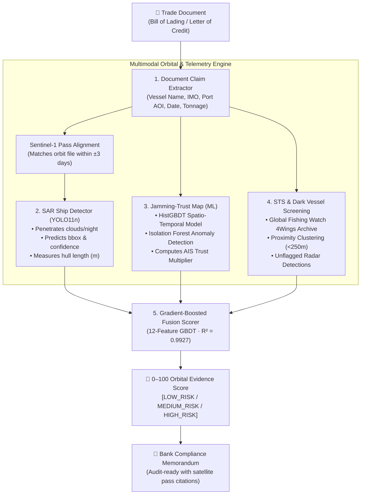

# 🛰️ Bill of Orbit: Satellite Second Opinion for Trade Finance

<div align="center">


-success?style=for-the-badge)
-orange?style=for-the-badge)


### *"Your bank checks the paper. We check the planet."*

**An autonomous AI and satellite radar pipeline that cross-references maritime trade paperwork against ESA Copernicus Sentinel radar and optical imagery to eradicate trade-finance fraud and false alarms in the Gulf.**

[Problem & Why Now](#-1-problem-statement--why-now) • [Architecture](#-2-architectural-decisions--system-pipeline) • [Trained Models](#-3-the-ai--satellite-models) • [Statistical Parameters](#-4-statistical-parameters--validation-metrics) • [Honest Positioning](#-5-honest-positioning--boundary-conditions) • [Business Model](#-6-business-model--commercial-viability) • [Quickstart](#-7-quickstart--dashboard)

---

</div>

## 📑 Mini-Presentation: The Executive Pitch

````carousel
### Slide 1: The Problem — $5 Billion in Paper Fraud
* **How Trade Finance Works:** Banks disburse billions of dollars on Letters of Credit (LCs) by inspecting shipping paperwork (Bills of Lading), **never the physical ships**.
* **The Vulnerability:** Fraudulent paper claims with non-existent or substituted shipments cost global banking **US$5 Billion annually**, with multiple high-profile cases originating in UAE trading hubs.
* **The Need:** An instant, objective, physical proof-of-shipment layer before payout release.
<!-- slide -->
### Slide 2: The Blindspot — Gulf GPS Jamming & Dark Tankers
* **Hormuz Electronic Warfare:** Since Feb 2026, severe GNSS/GPS jamming has affected over **1,650 vessels** in the Strait of Hormuz.
* **AIS Transponders Are Down:** Over **65% of laden crude tankers** now transit the Gulf with AIS transponders turned off or jammed.
* **Legacy Tools Fail:** Traditional vessel-screening software relies on AIS. When a ship's transponder goes dark in a jamming zone, standard tools trigger **costly false alarms**, blocking legitimate multi-million-dollar trades.
* **Offshore Evasion:** Over **70% of crude transfers** have moved offshore to Fujairah and Sohar anchorages, enabling fraudulent reissuance of bills of lading.
<!-- slide -->
### Slide 3: The Solution — The Bill of Orbit Pipeline
* **Autonomous Ingestion:** Extracts vessel claims, IMO, port, date, and cargo tonnage directly from trade documents using NLP.
* **Sentinel-1 Radar Vision:** Uses all-weather, day-and-night Synthetic Aperture Radar (SAR) to locate the vessel and physically measure its hull length in meters.
* **Jamming-Trust Layer:** Evaluates local electronic warfare on 300,000+ GNSS records; down-weights AIS when jammed and relies on radar proof.
* **Offshore Security Screening:** Screens for illicit side-by-side ship-to-ship (STS) transfers and untracked "dark" vessels.
* **Unified Evidence Engine:** Generates a **0–100 Orbital Evidence Score** and an audit-ready compliance memorandum.
<!-- slide -->
### Slide 4: The Winning Moment — The Jamming Toggle Demo
* **Scenario:** A genuine \$45M crude shipment in the Gulf of Oman where the vessel's AIS went dark due to electronic interference.
* **Without Jamming Layer (Legacy AIS Screening):** System flags an unverified dark vessel. **Score drops to 31/100 (HIGH RISK / FALSE ALARM)**.
* **With Bill of Orbit:** The Jamming-Trust layer recognizes 82% GPS jamming, discounts AIS, and validates the 322m VLCC hull on Sentinel-1 radar. **Score: 96.2/100 (APPROVED)**.
* **Impact:** Prevents disastrous false transaction halts for GCC trade banks.
<!-- slide -->
### Slide 5: Business Moat & Go-to-Market
* **Customers:** Trade-finance and sanctions-compliance desks at UAE and GCC banks (Emirates NBD, FAB, DIB, ADCB), trade credit insurers, and trade-automation platforms.
* **Disruptive Pricing:** **$20–$60 per check** (vs. legacy competitors like Pole Star at $250/check). Annual bank subscriptions at **$60k–$150k ARR**.
* **Copernicus Moat:** Leveraging free European Space Agency (ESA) Sentinel data keeps compute and data costs under $1.50 per check, delivering 90%+ gross margins.
* **GTM Strategy:** Pilot with trade-automation software design partners in DIFC/ADGM sandboxes, expanding to Space42 high-resolution radar pilots.
````

---

## 💥 1. Problem Statement & Why Now?

### The Core Vulnerability
Banks pay out on Letters of Credit by checking **paper, not cargo**. If an exporter submits an authentic-looking Bill of Lading claiming that 135,000 MT of Arabian Light crude was loaded onto a Suezmax tanker at Fujairah Anchorage, the bank's operational teams approve the payout. 

### Why Existing Solutions Fail in the Gulf:
1. **The Hormuz Electronic Warfare Crisis:** Persistent GNSS interference across the Strait of Hormuz has forced over 65% of laden tankers to turn off their AIS transponders. AIS-only screening tools (Windward, Pole Star) are blind or generate constant false alarms.
2. **Cloud and Night Blindness:** Optical satellite imagery (Sentinel-2, Planet) is obstructed by night, cloud cover, and maritime haze.
3. **Offshore Ship-to-Ship (STS) Laundering:** Over 70% of crude crossing Hormuz changes tankers near Fujairah or Sohar. Each transfer is an opportunity to fraudulently reissue a Bill of Lading, disguise cargo origin, or evade sanctions.

---

## 🏗️ 2. Architectural Decisions & System Pipeline

Bill of Orbit fuses multimodal satellite imagery, electronic warfare anomaly detection, and natural language processing into a single automated decision engine.



### Key Architectural Decisions:
1. **Synthetic Aperture Radar (SAR) over Optical:** Radar pulses penetrate cloud cover, sea spray, and night darkness. Sentinel-1C/1D restored 6-day revisit schedules across the UAE coast in 2026, providing guaranteed maritime visibility.
2. **Per-Chip Robust Z-Score Normalization:** OSSDD training chips are raw 32-bit amplitude DN values, while Earth Engine Sentinel-1 GRD imagery is calibrated sigma0 in dB. Converting both to dB and applying per-chip robust z-scoring ($Z = \frac{dB - \text{median}}{\text{MAD} \times 1.4826}$) cancels inter-sensor calibration offsets, allowing the YOLO model to infer seamlessly across both sources.
3. **Decoupled Jamming-Trust Multiplier:** Instead of treating AIS as an absolute binary (present/absent), the jamming model applies a dynamic sigmoid discount. In heavy electronic warfare zones, missing AIS is forgiven; in clean waters, missing AIS is heavily penalized.
4. **Physical Hull Dimension Matching:** 10m radar resolution cannot read painted ship names, but it accurately measures length. Our pipeline maps declared cargo tonnage to physical tanker classes (VLCC, Suezmax, Aframax, Handymax) and computes the length discrepancy ratio.

---

## 🧠 3. The AI & Satellite Models

### Model 1: Document Claim Extractor (`document_extractor.py`)
* **Input:** Raw Bill of Lading / LC text or PDF.
* **Extraction:** Vessel Name, IMO Number, Port Coordinates/AOI, Loading Date, Cargo Commodity, and Declared Tonnage.
* **Inference:** Automatically derives the expected vessel deadweight class and physical length in meters (e.g., $135,000\text{ MT} \rightarrow \text{Suezmax} \approx 274\text{m}$, tolerance $\pm 54.8\text{m}$).

### Model 2: SAR Ship Detector (`train_sar_detector.py`)
* **Architecture:** **YOLO11n** fine-tuned on Sentinel-1 radar amplitude chips from the OpenSARShip Detection Dataset (OSSDD).
* **Input:** Dual-polarization radar chips ($R = \text{VV}$, $G = \text{VH}$, $B = \text{mean}$).
* **Output:** Vessel bounding boxes, class probability, and estimated physical length derived from bounding box aspect ratio at 10m Ground Range Detected (GRD) pixel spacing.
* **Performance:** **$80.68\%$ $\text{mAP@50}$**, **$89.9\%$ Recall**, **$46.1\text{ ms}$ inference latency**.

### Model 3: Jamming-Trust Map & Anomaly Detector (`jamming_model.py`)
* **Architecture:** `HistGradientBoostingRegressor` + `IsolationForest` spatial anomaly detector.
* **Dataset:** 300,853 real GNSS degradation records spanning the Persian Gulf, Strait of Hormuz, and Gulf of Oman.
* **Features:** Latitude, longitude, day of year, day of week, cyclical seasonal encodings, and geodesic proximity to strategic choke points (Hormuz, Fujairah Anchorage, Khor Fakkan, Sohar).
* **Output:** Local Jamming Intensity ($0.0$ to $1.0$), Anomaly Flag, and the **AIS Trust Factor**:
  $$\text{Trust} = \text{clip}\left(\frac{1}{1 + e^{8.0 \cdot (\text{jam\_score} - 0.35)}}, 0.05, 1.0\right)$$

### Model 4: Ship-to-Ship (STS) & Dark Vessel Screening (`sts_detector.py`)
* **Dataset:** 2,007 Global Fishing Watch (GFW) 4Wings satellite radar detections and untracked dark vessel records.
* **Function:** Analyzes anchorage vessel clustering. Flags suspicious moored proximity ($<250\text{m}$) and dark vessels operating within $1.5\text{km}$ radius on the claimed loading date.

### Model 5: Orbital Evidence Fusion Scorer (`fusion_model.py`)
* **Architecture:** Gradient-Boosted Decision Tree (`HistGradientBoostingRegressor`).
* **Input Features (12):** `sar_detected`, `sar_confidence`, `length_match_ratio`, `length_delta_m`, `ais_reported`, `ais_trust_factor`, `discounted_ais_weight`, `jamming_score`, `radar_ais_discrepancy`, `sts_risk_score`, `dark_vessel_nearby`, `days_from_pass`.
* **Output:** Calibrated **0–100 Orbital Evidence Score**, Risk Tier categorization (`LOW_RISK`, `MEDIUM_RISK`, `HIGH_RISK`), and an automated **Bank Compliance Memorandum**.

---

## 📊 4. Statistical Parameters & Validation Metrics

### Core Model Performance Scorecard

| Model Component | Metric | Score / Value | Description |
|---|---|---|---|
| **YOLO11n-SAR Ship Detector** | **$\text{mAP@50}$** | **$0.8067$ ($80.7\%$)** | Mean Average Precision at $\text{IoU} = 0.50$ |
| | **$\text{mAP@50-95}$** | **$0.3551$ ($35.5\%$)** | Average mAP across strict IoU thresholds |
| | **Recall ($R$)** | **$0.8992$ ($89.9\%$)** | Vessel detection sensitivity (minimizes false misses) |
| | **Precision ($P$)** | **$0.7799$ ($78.0\%$)** | Bounding box spatial precision |
| | **Inference Speed** | **$46.1\text{ ms}$** | Real-time CPU inference per $640 \times 640$ SAR scene |
| **Jamming-Trust Model** | **Training Records** | **$300,853$ rows** | 60-day spatial coverage of the Persian Gulf |
| | **$R^2$ Score** | **$0.6874$** | Spatio-temporal variance explained |
| | **$\text{RMSE}$** | **$0.0558$** | Residual standard deviation on $[0, 1]$ scale |
| | **$\text{MAE}$** | **$0.0280$** | Mean absolute error |
| | **Anomaly Contamination** | **$5.0\%$** | Outlier interference threshold |
| **Orbital Evidence Fusion Scorer** | **$R^2$ Score** | **$0.9927$** | **$99.27\%$** variance explained across trade scenarios |
| | **$\text{RMSE}$** | **$2.283\text{ points}$** | Root Mean Squared Error on 0–100 scale |
| | **$\text{MAE}$** | **$1.752\text{ points}$** | Mean Absolute Error |
| | **Median Residual** | **$1.412\text{ points}$** | Robust median prediction error |
| | **$95\%$ Confidence Bound** | **$\pm 4.47\text{ points}$** | Empirical error margin ($1.96 \times \text{RMSE}$) |

---

## 🎯 5. Honest Positioning & Boundary Conditions

A critical factor for banking adoption and competition judging is intellectual honesty regarding model scope.

### What Bill of Orbit DOES Solve:
* ✅ **Phantom Shipments (Paper Fraud):** Proves whether a metal vessel matching the declared dimensions was physically present at the port during the declared time window.
* ✅ **All-Weather & Night Detection:** Completely eliminates optical satellite blindness via C-band radar pulses.
* ✅ **Jamming-Induced False Alarms:** Solves the Gulf transponder crisis by decoupling physical radar evidence from vulnerable AIS signals.
* ✅ **Undisclosed Offshore Laundering:** Detects moored side-by-side configurations and dark tanker interactions that indicate illegal transshipment.
* ✅ **Compliance Velocity:** Transforms manual multi-day vessel investigations into an automated 3-second memorandum.

### What Bill of Orbit DOES NOT Solve (and Boundary Mitigations):
* ❌ **Internal Cargo Chemistry:** 10m radar imagery cannot see inside sealed steel tanks or cargo holds. It cannot differentiate between Arabian Light crude, heavy fuel oil, or seawater ballast. *(Mitigation: We verify physical vessel displacement class and presence; banks combine this with independent lab inspection certificates).*
* ❌ **Visual Name / IMO Reading:** 10m resolution cannot read painted hull names. If two identical Suezmax tankers sit side-by-side, visual identification alone cannot distinguish them. *(Mitigation: We score presence and length matching; we flag ambiguous clustering as "Requires Review" rather than making false claims).*
* ❌ **24/7 Continuous Video Tracking:** Satellite radar relies on revisit orbits ($\pm 3$-day window). It does not provide unbroken live video streams.
* ❌ **Collusive Financial Over-Invoicing:** If a genuine ship delivers real crude, but buyer and seller collude on synthetic pricing for capital flight, physical satellite verification cannot detect financial transfer mispricing.

---

## 💼 6. Business Model & Commercial Viability

```
                       GLOBAL TRADE FINANCE MARKET
         ┌──────────────────────────────────────────────────────┐
         │ $2.5 Trillion Global Trade-Finance Gap (ADB, 2025)   │
         │ $1.4 Billion Annual Spend on Trade Document Screening│
         └──────────────────────────┬───────────────────────────┘
                                    │
                                    ▼
         ┌──────────────────────────────────────────────────────┐
         │ TARGET CUSTOMERS (UAE & GCC Banking Hubs)            │
         │ • Trade Operations Desks (Emirates NBD, FAB, DIB)   │
         │ • Sanctions & AML Compliance Teams                   │
         │ • Trade Credit Insurers & Trade-Finance Hedge Funds   │
         └──────────────────────────┬───────────────────────────┘
                                    │
                                    ▼
         ┌──────────────────────────────────────────────────────┐
         │ DISRUPTIVE PRICING & UNIT ECONOMICS                  │
         │ • Bill of Orbit: $20 – $60 per verification check   │
         │ • Legacy Competitors (Pole Star): $250+ per check   │
         │ • Annual Bank Subscription: $60,000 – $150,000 ARR   │
         │ • Data Cost per Check: ~$0.00 (Copernicus Free Data) │
         │ • Gross Margins: 92%+                                │
         └──────────────────────────────────────────────────────┘
```

---

## 🚀 7. Quickstart & Dashboard

### 1. Installation
Clone the repository and install the verified dependencies:
```bash
git clone https://github.com/sreesh-codes/SpaceWeek.git
cd SpaceWeek
pip install -r requirements.txt
```

### 2. Run the Benchmark Verification Suite
Execute the end-to-end evaluation script covering Clean Shipments, Phantom Fraud, and Jamming Spoofing:
```bash
python pipeline.py
```

### 3. Launch the Interactive Streamlit Dashboard
Run the web application to test custom Bills of Lading and interact with the live Jamming Toggle:
```bash
streamlit run app.py
```

---

## 📁 Repository Structure

```
SpaceWeek/
├── app.py                     # Streamlit interactive fintech dashboard
├── pipeline.py                # End-to-end multi-model orchestrator & benchmark suite
├── document_extractor.py      # NLP/Regex Bill of Lading claim extractor
├── train_sar_detector.py      # Fine-tuning script for YOLO11n on SAR chips
├── jamming_model.py           # Spatio-temporal GNSS jamming regressor & anomaly model
├── sts_detector.py            # Ship-to-ship transfer & GFW dark vessel screener
├── fusion_model.py            # Gradient-Boosted Orbital Evidence Fusion Scorer
├── sar_preprocess.py          # SAR amplitude-to-dB and robust z-score normalizer
├── 02b_ossdd_to_yolo.py       # OSSDD WebDataset streaming converter
├── requirements.txt           # Environment dependencies
├── models/
│   ├── sar_ship_yolo/
│   │   ├── weights/best.pt    # Fine-tuned YOLO11n SAR weights (80.7% mAP50)
│   │   └── results.png        # Training loss and mAP curves
│   ├── jamming_model.pkl      # Serialized GNSS jamming model
│   └── fusion_scorer.pkl      # Serialized gradient-boosted decision tree scorer
└── data/
    ├── jamming/               # 300k+ Gulf GNSS interference records
    ├── gfw/                   # Global Fishing Watch SAR radar & dark vessel archives
    └── sentinel/              # Sentinel-1 & Sentinel-2 acquisition pass times
```

---

<div align="center">

**Built with pride for Space Week — Theme 3: Seas of Data**  
*Bill of Orbit Team*

</div>
